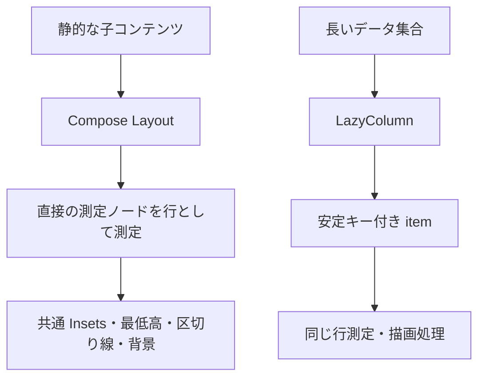

# Form / List 共有行描画基盤

Issue #18 の内部描画基盤に関する技術判断と検証結果を記録する。公開 API、最終的な Form / List / Section の寸法・Style は後続 Issue で決める。

## 技術判断

- 静的な子は Compose `Layout` の直接の `Measurable` ごとに一行として測定する。子を一度ずつ測り、行の最小高・上下余白・左右 Insets を適用し、共有の背景と区切り線を描く。
- `SubcomposeLayout` は採用しない。静的なコンテンツは通常の Compose composition で構築でき、行ごとの再 composition は必要ない。測定時に構成を遅らせる利点がなく、既存の Compose 状態と要素の同一性を保てる `Layout` が要件を満たす。
- 長いデータ集合には Compose 標準の `LazyColumn` を使い、各安定キー付き item の中で同じ行測定・描画処理を呼ぶ。Section 全体を一つの Lazy item にまとめない。
- 行メトリクスと面形状は内部パラメーターとし、共通基盤に最終寸法を固定しない。Preview・テストでは横 Insets 16dp、上下余白 8dp、最低高 44dp、区切り線 0.5dp、Section 背景の角丸 24dp を描画確認用の候補値として渡す。これらは Form / List の公開既定値を確定しない。
- 描画基盤は入力値やフォーカスを保持しない。通常の composition が子の状態を管理し、Lazy item は安定キーで位置変更後も同じ行として扱う。

## 識別境界と制約

Compose は任意の Composable 呼び出し境界を Layout の子として公開しないため、子 Composable の呼び出し数と直接の測定ノード数は一致するとは限らない。

- 0 個のノードを出す子は行を作らない。
- 複数の直接ノードを出す子はノードごとに行になる。
- 複数の要素を一行にまとめるときは標準 `Row` / `Column` / `Box` で囲み、その単一レイアウトノードを一行として扱う。
- Lazy item 内でも item コンテンツが複数の直接ノードを出すと複数行になる。item を一行の構造として表す場合も標準レイアウトでまとめる。
- 静的 `Layout` は全ての静的子を構成する。長いリストを全件構成しない要件は `LazyColumn` 側で満たす。

この境界は SwiftUI の `Form` / `Section` の宣言的な構成に対応する内部実装上の制約であり、PommeRow の公開や呼び出し時の自動グループ化を追加する理由にはしない。参照: [SwiftUI Form](https://developer.apple.com/documentation/swiftui/form), [SwiftUI Section](https://developer.apple.com/documentation/swiftui/section), [Compose custom layouts](https://developer.android.com/develop/adaptive-apps/guides/custom), [Compose lazy lists](https://developer.android.com/develop/ui/compose/lists).

## 検証

- [x] 静的な直接ノード、標準レイアウトでまとめた子、空レイアウト、条件付き行の追加を確認。
- [x] 条件付き更新後も入力値とフォーカスが保たれることを確認。
- [x] 500 行の LazyColumn で画面外 item が初期構成されず、安定キーによる先頭行追加後も可視行の入力値が保たれることを確認。
- [x] 静的 / Lazy の Preview を Light / Dark でレンダリングし、Section 背景の角丸 24dp を含む4枚の実画像を生成・一致検証。
- [x] Preview は静的な描画確認に限定し、条件更新は UI テストから状態を直接変更して検証。

検証は API 36 Emulator で実行した。`:pomme:assembleDebug` / `:sample:assembleDebug`、両モジュールの `lintDebug` と `testDebugUnitTest`、`:sample:connectedDebugAndroidTest`（4 件すべて成功）、`:sample:updateDebugScreenshotTest` および `:sample:validateDebugScreenshotTest` が成功。
